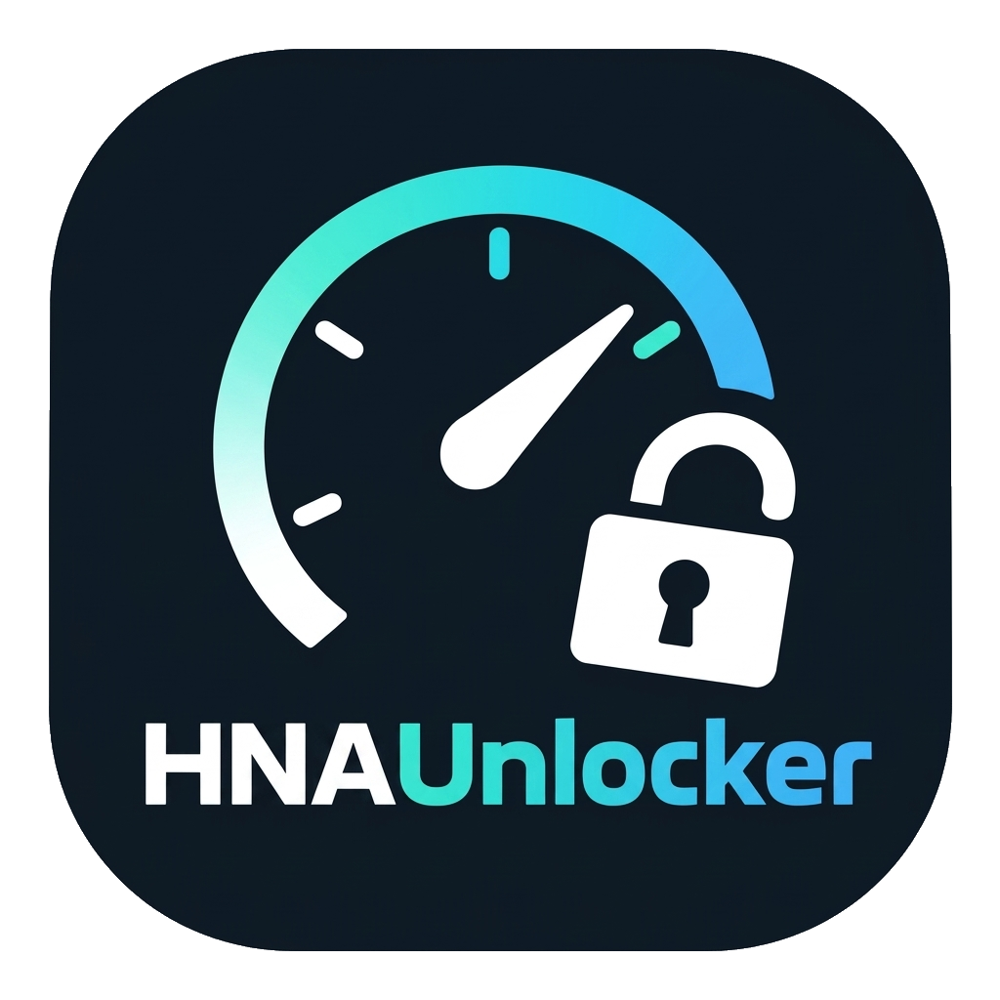

# HNAUnlocker

  

[简体中文](#简体中文) | [English](#english)

## 简体中文

**崩坏：因缘精灵（Honkai: Nexus Anima）** 帧率解锁工具，基于 [L1angYun/HSRUnlocker](https://github.com/L1angYun/HSRUnlocker)（GPL-3.0）改编移植。支持 10–480 FPS 上限、FOV 调整，以及防止角色在低仰角或近距离镜头下淡出（AntiFade）功能。

> 移动端 UI 选项代码已保留以便后续版本适配，由于当前 PC 测试版（`0.75.x`）缺少云游戏触控模块，界面开关暂时禁用。

**下载：** [GitHub Releases](https://github.com/Schrodingers-Neko/HNAUnlocker/releases)

需要 Windows 10 22H2（19045）或更新的 Windows 版本（x64）和管理员权限。Windows 10 和 Windows 11 使用同一个安装包。缺少运行组件时，安装程序会从微软下载。

### 快速开始

1. 下载并运行 `HNAUnlocker-版本号-win-x64-Setup.exe`，安装后使用快捷方式打开工具。
2. 首次启动会搜索 `NexusAnima.exe`。只找到一个时自动保存；找到多个时请选择客户端；未找到时手动浏览。
3. 设置目标帧率和所需选项，点击「启动游戏」，或点击「连接游戏」连接已运行的客户端。
4. 点击「停止并还原」结束本次会话并尝试还原修改，游戏继续运行。最小化后可双击托盘图标恢复窗口。

客户端路径会保存并在下次启动时显示，前提是文件仍然有效。路径旁的搜索按钮可重新扫描，当前选择会保留；可在下拉列表切换客户端，悬停查看完整路径。

### 反馈与开发

会话失败时，可从应用内提示打开 [GitHub Issues](https://github.com/Schrodingers-Neko/HNAUnlocker/issues)。请附工具版本、复现步骤和必要的脱敏错误行；无需上传完整日志、个人路径、账号信息或内存转储。安全问题请参阅[安全说明](SECURITY.md)。

可从失败提示或「运行日志」导出当前会话的诊断 TXT。文件包含工具版本、Windows 版本和帧率读写错误码，不包含原始日志、文件路径或进程编号。分享前请先检查。

构建、测试和发布步骤见[参与开发](CONTRIBUTING.md)；HNA 各功能的底层实现与参考地址说明见 [docs/HNA-Internals.md](docs/HNA-Internals.md)。本项目在开发中使用 AI 辅助，未经独立安全审计。

这是非官方工具。修改游戏进程可能违反游戏服务条款并带来账号风险。

## English

An FPS unlocker for **Honkai: Nexus Anima** (`NexusAnima.exe`), adapted from [L1angYun/HSRUnlocker](https://github.com/L1angYun/HSRUnlocker) under GPL-3.0. Supports a 10–480 FPS cap, FOV adjustment, and character anti-fade (prevents character dithering at both low camera angles and close camera distances).

> Mobile UI launch code is retained for future game builds, with the toggle disabled while the `0.75.x` PC beta lacks `CloudGame` / `CloudInput`.

**Download:** [GitHub Releases](https://github.com/Schrodingers-Neko/HNAUnlocker/releases)

Requires Windows 10 22H2 (build 19045) or later and administrator privileges. The same x64 installer works on Windows 10 and Windows 11. Setup downloads missing runtime components from Microsoft.

### Quick start

1. Download and run `HNAUnlocker-version-win-x64-Setup.exe`, then open the tool from its shortcut.
2. On first launch, the tool looks for `NexusAnima.exe`. It saves a single match automatically. If it finds several clients, choose one; if it finds none, browse to the executable.
3. Set your target FPS and other options. Choose **Launch game** or **Connect to game** if the client is already running.
4. Choose **Stop and restore** to end the session and attempt to restore the changes while the game keeps running. Double-click the tray icon to restore a minimized window.

The tool saves the selected client path and displays it at startup if the file is still valid. The search button rescans and keeps your selection. Use the dropdown to switch clients and hover to see the full path.

### Feedback and development

If a session fails, the notice in the app links to [GitHub Issues](https://github.com/Schrodingers-Neko/HNAUnlocker/issues). Include the app version, steps to reproduce, and any relevant sanitized error lines. Leave out full logs, personal paths, account details, and memory dumps. For security issues, see the [security policy](SECURITY.md).

Export a TXT report for the current session from the failure notice or **Activity log**. It includes the app and Windows versions and frame cap error codes, without raw logs, file paths, or process IDs. Review it before sharing.

See [Contributing](CONTRIBUTING.md#english) for build, test, and release instructions, and [docs/HNA-Internals.md](docs/HNA-Internals.md) for the technical reference on HNA's FPS, FOV, and AntiFade implementation. The project is developed with AI assistance and has not undergone an independent security audit.

This is an unofficial tool. Modifying the game process may violate the game's terms of service and put your account at risk.

## Attribution & License

Derived from [L1angYun/HSRUnlocker](https://github.com/L1angYun/HSRUnlocker) and modified for Honkai: Nexus Anima.

[GPL-3.0-only](LICENSE) · [Third-party notices](THIRD_PARTY_NOTICES.md)
